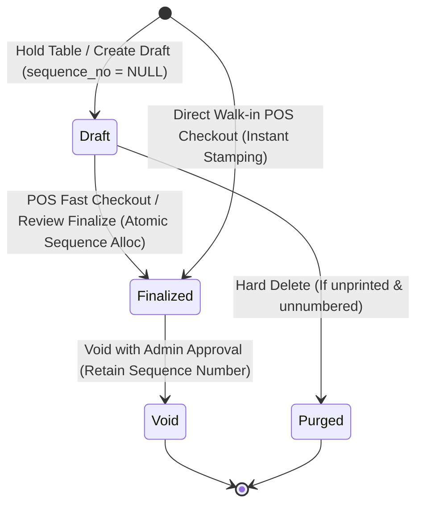

# Specification Document: Present Invoice & POS Module
## ឯកសារបញ្ជាក់លម្អិតស្ថាបត្យកម្ម និងកូដម៉ូឌុលវិក្កយបត្រ (Present Invoice Module Specification)

| ព័ត៌មានទូទៅ (Metadata) | ខ្លឹមសារបញ្ជាក់ (Specification Details) |
|---|---|
| **ឈ្មោះប្រព័ន្ធ / Project** | `leashal_etum` (LEAS E-TUM Restaurant & POS Management System) |
| **ម៉ូឌុលគោល / Target Module** | **Present Invoice & POS Terminal Module** (វិក្កយបត្រ, ការទូទាត់ប្រាក់ & ម៉ាស៊ីន POS) |
| **កាលបរិច្ឆេទវិភាគ / Generated Date** | 2026-10-14 |
| **ស្ថានភាពកូដ / Current Status** | Active / Production-grade Monolith Architecture |
| **បច្ចេកវិទ្យាស្នូល / Core Stack** | Laravel 12+, Inertia.js v2/v3, React 19, TypeScript, Tailwind CSS, MySQL 8 |
| **គោលបំណងឯកសារ / Purpose** | ផ្ដល់នូវឯកសារវិភាគលម្អិតកម្រិតស្ថាបត្យកម្ម (Architectural Specification) អំពីទិន្នន័យ (Database Schemas), រូបមន្តគណនាហិរញ្ញវត្ថុ (Financial Engine), ដំណើរការការងារ (Workflows), សុវត្ថិភាព និងកូដប្រភព (Source Code) ដើម្បីយកមកវិភាគ កែលម្អ ឬធ្វើសវនកម្ម (Analysis, Audit & Refactoring) |

---

## តារាងមាតិកា (Table of Contents)

1. [ទិដ្ឋភាពទូទៅនៃស្ថាបត្យកម្ម (Architecture Overview)](#1-ទិដ្ឋភាពទូទៅនៃស្ថាបត្យកម្ម-architecture-overview)
2. [រចនាសម្ព័ន្ធថត និងទីតាំងកូដ (Directory Structure & Code Map)](#2-រចនាសម្ព័ន្ធថត-និងទីតាំងកូដ-directory-structure--code-map)
3. [គ្រោងទិន្នន័យ Authoritative Database Schema](#3-គ្រោងទិន្នន័យ-authoritative-database-schema)
4. [ម៉ាស៊ីនគណនាប្រាក់ និងច្បាប់ហិរញ្ញវត្ថុ (Financial Calculation Engine)](#4-ម៉ាស៊ីនគណនាប្រាក់-និងច្បាប់ហិរញ្ញវត្ថុ-financial-calculation-engine)
5. [វដ្តជីវិតវិក្កយបត្រ និងការបង្កើតលេខកូដ (Lifecycle & Sequence Numbering)](#5-វដ្តជីវិតវិក្កយបត្រ-និងការបង្កើតលេខកូដ-lifecycle--sequence-numbering)
6. [ការវិភាគលើ Actions និង Business Logic នីមួយៗ](#6-ការវិភាគលើ-actions-និង-business-logic-នីមួយៗ)
7. [ប្រព័ន្ធបោះពុម្ព និង Hardware Print Engine](#7-ប្រព័ន្ធបោះពុម្ព-និង-hardware-print-engine)
8. [ស្ថាបត្យកម្ម Frontend (POS Terminal UX & Components)](#8-ស្ថាបត្យកម្ម-frontend-pos-terminal-ux--components)
9. [តារាង Routes & API Endpoints](#9-តារាង-routes--api-endpoints)
10. [ចំណុចខ្លាំង និងអនុសាសន៍សម្រាប់ការវិភាគ (Analysis & Recommendations)](#10-ចំណុចខ្លាំង-និងអនុសាសន៍សម្រាប់ការវិភាគ-analysis--recommendations)

---

## 1. ទិដ្ឋភាពទូទៅនៃស្ថាបត្យកម្ម (Architecture Overview)

ម៉ូឌុល **Invoice (Documents)** នៅក្នុងប្រព័ន្ធ `leashal_etum` ត្រូវបានសាងសង់ឡើងតាមទម្រង់ **Feature-Sliced Modular Monolith** ក្នុង Laravel ដោយរួមបញ្ចូលគ្នាយ៉ាងស្អិតរមួតរវាង៖
- **Real-Time Food Stall / Restaurant POS Terminal**: ការលក់ផ្ទាល់នៅបញ្ជរ, ការកាន់តុ (Dine-in Table Holding), ការគិតលុយលឿន (Fast Checkout) និងការទូទាត់តាម KHQR / សាច់ប្រាក់។
- **Deterministic Financial Ledger (Re-entry & Audit)**: ការរក្សាទុកលេខវិក្កយបត្របន្តបន្ទាប់ដោយគ្មានចន្លោះ (Gapless Sequence Numbering) ក្រោមការគ្រប់គ្រងនៃ Accounting Periods (វេន/វគ្គគណនេយ្យ)។
- **Historical Snapshot Invariance**: ការរក្សាទុក Snapshot ឈ្មោះទំនិញ, តម្លៃឯកតា, និងខ្នាតគិតលុយ នៅពេលលក់ ដើម្បីការពារកុំឱ្យការកែប្រែតម្លៃទំនិញនៅថ្ងៃក្រោយ ប៉ះពាល់ដល់ប្រវត្តិវិក្កយបត្រចាស់ៗ។
- **Direct Hardware Printing Engine**: គាំទ្រការព្រីនវិក្កយបត្រកម្ដៅខ្នាតតូច 80mm Thermal Receipt, វិក្កយបត្រផ្លូវការ A5 Formal Invoice, និងការព្រីនបន្តបន្ទាប់ជាបាច់ (Continuous Range Batch Printing)។

```mermaid
graph TD
    UI[Frontend: React 19 POS Terminal / Documents Register] -->|Inertia.js Protocol| Routes[routes/web.php]
    Routes --> Controller[DocumentController & DocumentPrintController]
    
    subgraph Core Domain Actions [app/Features/Documents/Actions]
        Controller -->|Fast Pay| COA[CheckoutOrderAction]
        Controller -->|Dine-In Hold| HTOA[HoldTableOrderAction]
        Controller -->|Manual Batch Entry| CDD[CreateDraftDocument]
        Controller -->|Void Invoice| VDA[VoidDocumentAction]
        Controller -->|Purge Draft| PDDA[PurgeDraftDocumentAction]
    end

    subgraph Mathematical Services [app/Features/Documents/Services]
        COA --> Calc[DocumentCalculator]
        HTOA --> Calc
        CDD --> Calc
        Calc --> Money[Money Support - Integer Cents Engine]
    end

    subgraph Data Models & Persistence [MySQL 8]
        COA -->|Lock & Numbering| Period[Period Model]
        COA --> Doc[Document Model]
        COA --> Items[DocumentItem Model (Snapshots)]
        COA --> Audit[AuditService (Polymorphic Audit)]
        COA --> Loyalty[Customer Loyalty & Tiers]
    end
```

---

## 2. រចនាសម្ព័ន្ធថត និងទីតាំងកូដ (Directory Structure & Code Map)

### ២.១ Backend Files (PHP / Laravel)
```text
app/
├── Features/
│   └── Documents/
│       ├── Actions/
│       │   ├── CheckoutOrderAction.php      # ដំណើរការគិតលុយភ្លាមៗ + ចេញលេខវិក្កយបត្រផ្លូវការ
│       │   ├── HoldTableOrderAction.php     # កាន់ការកុម្ម៉ង់ទុកតាមតុ (Dine-in Draft)
│       │   ├── CreateDraftDocument.php      # បង្កើត Draft វិក្កយបត្រទូទៅ (Re-entry)
│       │   ├── VoidDocumentAction.php       # មោឃភាពវិក្កយបត្រចោល (រក្សាលេខកូដ)
│       │   └── PurgeDraftDocumentAction.php # លុប Draft ចោលជាអចិន្ត្រៃយ៍ (Hard Purge)
│       ├── Http/
│       │   └── Controllers/
│       │       ├── DocumentController.php       # Handle POS Terminal, Checkout, Listing
│       │       └── DocumentPrintController.php  # Handle 80mm, A5, Batch Range Printing & Print Logs
│       └── Services/
│           └── DocumentCalculator.php       # Strict Financial Calculation Service
├── Models/
│   ├── Document.php                         # Authoritative Document/Invoice Model
│   ├── DocumentItem.php                     # Line items with snapshot fields
│   ├── DocumentRevision.php                 # Mutation audit history (Before/After JSON)
│   ├── PrintLog.php                         # Idempotent print hardware requests & checksums
│   └── Period.php                           # Accounting period controlling numbering sequence
└── Support/
    ├── Money/
    │   └── Money.php                        # Decimal-string to Integer-cents converter
    └── Audit/
        └── AuditService.php                 # Immutable append-only audit trail
```

### ២.២ Database Migration Files
```text
database/migrations/
├── 2026_10_13_000005_create_periods_and_documents_tables.php
└── 2026_10_13_000006_create_approvals_revisions_and_print_logs_tables.php
```

### ២.៣ Frontend Files (React 19 / TypeScript / Inertia)
```text
resources/js/pages/documents/
├── create.tsx        # Live POS Terminal (Menu grid, Cart, Fast Checkout, KHQR, Tables)
├── index.tsx         # Document Register (Invoice ledger, search, filters, status)
├── show.tsx          # Single Invoice Details View
├── preview-80mm.tsx  # Thermal Receipt 80mm (ESC/POS style responsive web view)
├── preview-a5.tsx    # Formal Business Invoice A5 Layout
└── preview-range.tsx # Continuous Range Batch Print Engine (Sequence range filter)
```

---

## 3. គ្រោងទិន្នន័យ Authoritative Database Schema

### ៣.១ តារាង `documents` (មេវិក្កយបត្រ)
គ្រប់គ្រងក្បាលវិក្កយបត្រ (Invoice Header), លេខរៀងផ្លូវការ, ទឹកប្រាក់សរុប, ស្ថានភាព និងទំនាក់ទំនងជាមួយអតិថិជន និងតុ។

```sql
CREATE TABLE `documents` (
  `id` BIGINT UNSIGNED AUTO_INCREMENT PRIMARY KEY,
  `period_id` BIGINT UNSIGNED NOT NULL,
  `provisional_order` INT UNSIGNED NOT NULL DEFAULT 1,
  `sequence_no` INT UNSIGNED NULL,                       -- លេខរៀងផ្លូវការ (NULL ប្រសិនបើនៅជា Draft)
  `document_number` VARCHAR(60) NULL UNIQUE,             -- លេខវិក្កយបត្រ ឧ. INV-P202610-0001
  `business_date` DATE NOT NULL,                         -- កាលបរិច្ឆេទប្រតិបត្តិការ
  `event_time` TIME NOT NULL,                            -- ម៉ោងចេញវិក្កយបត្រ
  `reference_identifier` VARCHAR(30) NULL,               -- សម្គាល់តុ ឬបន្ទប់ (ឧ. តុ ០១, VIP 01)
  `unit_count` INT UNSIGNED NOT NULL DEFAULT 0,          -- ចំនួនឯកតាសរុប
  `source_total` DECIMAL(12,2) NOT NULL,                 -- តម្លៃផ្ទៀងផ្ទាត់ប្រភព
  `source_total_verified` TINYINT(1) NOT NULL DEFAULT 0,
  `subtotal` DECIMAL(12,2) NOT NULL,                     -- សរុបរង (មុនបញ្ចុះតម្លៃ និងពន្ធ)
  `tax_amount` DECIMAL(12,2) NOT NULL DEFAULT 0.00,      -- ពន្ធសរុប
  `discount_amount` DECIMAL(12,2) NOT NULL DEFAULT 0.00, -- បញ្ចុះតម្លៃសរុប
  `grand_total` DECIMAL(12,2) NOT NULL,                  -- ប្រាក់ត្រូវទូទាត់ពិតប្រាកដ
  `amount_received` DECIMAL(12,2) NOT NULL,              -- ប្រាក់ទទួលពីភ្ញៀវ
  `change_amount` DECIMAL(12,2) NOT NULL,                -- ប្រាក់អាប់ជូនភ្ញៀវ
  `payment_method` VARCHAR(20) NOT NULL DEFAULT 'cash',  -- cash, card, qr_transfer, khqr
  `status` VARCHAR(20) NOT NULL DEFAULT 'draft',         -- draft, review, finalized, void
  `note` TEXT NULL,
  `print_settings_snapshot` JSON NULL,                   -- រក្សាទុកពុម្ព print នៅពេលចេញ
  `entry_settings_snapshot` JSON NULL,
  `kitchen_status` VARCHAR(20) NOT NULL DEFAULT 'pending',-- pending, cooking, ready, served
  `customer_id` BIGINT UNSIGNED NULL,                    -- ភ្ជាប់ជាមួយ loyalty CRM
  `points_earned` INT NOT NULL DEFAULT 0,
  `points_redeemed` INT NOT NULL DEFAULT 0,
  `created_by` BIGINT UNSIGNED NOT NULL,
  `updated_by` BIGINT UNSIGNED NOT NULL,
  `finalized_by` BIGINT UNSIGNED NULL,
  `finalized_at` TIMESTAMP NULL,
  `lock_version` INT UNSIGNED NOT NULL DEFAULT 0,        -- Optimistic Concurrency Control
  `created_at` TIMESTAMP NULL,
  `updated_at` TIMESTAMP NULL,
  
  UNIQUE KEY `uq_period_sequence` (`period_id`, `sequence_no`),
  INDEX `idx_period_status_date` (`period_id`, `status`, `business_date`),
  INDEX `idx_created_by_date` (`created_by`, `created_at`),
  CONSTRAINT `fk_docs_period` FOREIGN KEY (`period_id`) REFERENCES `periods` (`id`) ON DELETE RESTRICT,
  CONSTRAINT `fk_docs_customer` FOREIGN KEY (`customer_id`) REFERENCES `customers` (`id`) ON DELETE SET NULL,
  CONSTRAINT `fk_docs_creator` FOREIGN KEY (`created_by`) REFERENCES `users` (`id`) ON DELETE RESTRICT
) ENGINE=InnoDB DEFAULT CHARSET=utf8mb4 COLLATE=utf8mb4_unicode_ci;
```

### ៣.២ តារាង `document_items` (បន្ទាត់មុខទំនិញក្នុងវិក្កយបត្រ)
ប្រើប្រាស់ទម្រង់ **Snapshot Pattern** ដើម្បីផ្ដិតយកឈ្មោះ និងតម្លៃទំនិញនៅពេលចុចលក់៖

```sql
CREATE TABLE `document_items` (
  `id` BIGINT UNSIGNED AUTO_INCREMENT PRIMARY KEY,
  `document_id` BIGINT UNSIGNED NOT NULL,
  `product_id` BIGINT UNSIGNED NULL,
  `line_position` INT UNSIGNED NOT NULL,                 -- លេខរៀងបន្ទាត់ 1, 2, 3...
  `kitchen_status` VARCHAR(20) NOT NULL DEFAULT 'pending',
  `category_type_snapshot` VARCHAR(30) NOT NULL,
  `product_name_primary_snapshot` VARCHAR(180) NOT NULL, -- ឈ្មោះខ្មែរ (ឧ. ឡុកឡាក់សាច់គោ)
  `product_name_secondary_snapshot` VARCHAR(180) NULL,   -- ឈ្មោះអង់គ្លេស (ឧ. Beef Lok Lak)
  `unit_snapshot` VARCHAR(40) NOT NULL,                  -- ខ្នាត (ឧ. ចាន, កែវ, កំប៉ុង)
  `quantity` INT UNSIGNED NOT NULL,                      -- ចំនួនទិញ
  `master_price_at_entry` DECIMAL(12,2) NOT NULL,        -- តម្លៃដើមក្នុង Master Catalog
  `unit_price` DECIMAL(12,2) NOT NULL,                   -- តម្លៃលក់ជាក់ស្តែង
  `line_total` DECIMAL(12,2) NOT NULL,                   -- សរុបបន្ទាត់ (quantity * unit_price)
  `is_primary_package_snapshot` TINYINT(1) DEFAULT 0,
  `is_price_override` TINYINT(1) DEFAULT 0,
  `override_reason` TEXT NULL,
  `override_approved_by` BIGINT UNSIGNED NULL,
  `created_at` TIMESTAMP NULL,
  `updated_at` TIMESTAMP NULL,
  
  UNIQUE KEY `uq_document_line` (`document_id`, `line_position`),
  CONSTRAINT `fk_doc_items_doc` FOREIGN KEY (`document_id`) REFERENCES `documents` (`id`) ON DELETE CASCADE,
  CONSTRAINT `fk_doc_items_prod` FOREIGN KEY (`product_id`) REFERENCES `products` (`id`) ON DELETE SET NULL
) ENGINE=InnoDB DEFAULT CHARSET=utf8mb4 COLLATE=utf8mb4_unicode_ci;
```

### ៣.៣ តារាង `print_logs` (កំណត់ត្រាការព្រីនចេញ Hardware)
កត់ត្រាការព្រីនដោយប្រើ **UUID Request ID** ការពារការព្រីនស្ទួន និង **SHA-256 Checksum** ការពារការបន្លំវិក្កយបត្រ៖

```sql
CREATE TABLE `print_logs` (
  `id` BIGINT UNSIGNED AUTO_INCREMENT PRIMARY KEY,
  `document_id` BIGINT UNSIGNED NOT NULL,
  `format` VARCHAR(20) NOT NULL,                         -- '80mm', 'a5', 'pdf'
  `print_type` VARCHAR(20) NOT NULL DEFAULT 'original',  -- 'original', 'reprint'
  `request_id` CHAR(36) NOT NULL UNIQUE,                 -- Idempotency UUID
  `requested_by` BIGINT UNSIGNED NOT NULL,
  `requested_at` TIMESTAMP NOT NULL DEFAULT CURRENT_TIMESTAMP,
  `document_checksum` VARCHAR(64) NULL,                  -- SHA-256 Hash
  CONSTRAINT `fk_print_logs_doc` FOREIGN KEY (`document_id`) REFERENCES `documents` (`id`) ON DELETE RESTRICT
) ENGINE=InnoDB DEFAULT CHARSET=utf8mb4 COLLATE=utf8mb4_unicode_ci;
```

---

## 4. ម៉ាស៊ីនគណនាប្រាក់ និងច្បាប់ហិរញ្ញវត្ថុ (Financial Calculation Engine)

ប្រព័ន្ធ `leashal_etum` អនុវត្តតាមគោលការណ៍ **Financial Correctness** យ៉ាងម៉ឺងម៉ាត់បំផុត ដោយ **មិនប្រើប្រាស់ floating-point arithmetic (`0.1 + 0.2`) ក្នុង Domain Layer ជាដាច់ខាត** ព្រោះវាអាចបណ្ដាលឱ្យបាត់បង់កាក់សេន ឬមានគម្លាតលេខ។

### ៤.១ Support Class: `App\Support\Money\Money`
- គាំទ្រការបម្លែង Decimal String ទៅជា **Integer Cents** មុនពេលបូកដកគុណចែក៖
  $$\text{cents} = (\text{dollars} \times 100) + \text{fraction}$$
- កម្រិតខ្ពស់បំផុតការពារ Overflow: `MAX_CENTS = 999_999_999_999` (ត្រូវនឹង `DECIMAL(12,2)`)។
- កូដស្នូល៖
```php
public static function toCents(string $amount): int {
    $amount = trim($amount);
    if (! preg_match('/^-?\d{1,10}(?:\.\d{1,2})?$/D', $amount)) {
        throw new InvalidArgumentException('Invalid monetary amount.');
    }
    // បម្លែងទៅជា integer cents ដោយគ្មាន floating-point error
    [$whole, $fraction] = array_pad(explode('.', $amount, 2), 2, '');
    return ((int) $whole * 100) + (int) str_pad($fraction, 2, '0');
}

public static function fromCents(int $cents): string {
    return sprintf('%s%d.%02d', $cents < 0 ? '-' : '', intdiv(abs($cents), 100), abs($cents) % 100);
}
```

### ៤.២ កិច្ចសន្យាគណនា (Authoritative Calculation Contract)
អនុវត្តនៅក្នុង `App\Features\Documents\Services\DocumentCalculator`៖

$$\text{Line Total}_i = \text{Quantity}_i \times \text{Unit Price}_i$$
$$\text{Subtotal} = \sum_{i=1}^{n} \text{Line Total}_i$$
$$\text{Grand Total} = \text{Subtotal} + \text{Tax Amount} - \text{Discount Amount}$$
$$\text{Change Amount} = \text{Amount Received} - \text{Grand Total}$$

**ច្បាប់សុពលភាពហិរញ្ញវត្ថុ (Invariants):**
1. **No Negative Values**: `unit_price >= 0`, `tax_amount >= 0`, `discount_amount >= 0`, `amount_received >= 0`។
2. **Discount Bounded**: `discount_amount <= subtotal` (មិនអនុញ្ញាតឱ្យបញ្ចុះតម្លៃលើសតម្លៃទំនិញសរុបទេ)។
3. **Cash Payment Invariant**: ប្រសិនបើទូទាត់ជា `cash` នោះ `amount_received >= grand_total`។
4. **Electronic Payment Invariant**: ប្រសិនបើទូទាត់ជា `khqr`, `card`, ឬ `qr_transfer` នោះ `amount_received == grand_total` (គ្មានប្រាក់អាប់ទេ)។
5. **Dual Currency Display**:
   - អត្រាប្តូរប្រាក់គោលក្នុងប្រព័ន្ធ៖ $1\text{ USD} = 4,100\text{ KHR}$
   - បង្ហាញជាប្រាក់រៀល៖ $\text{KHR Amount} = \text{USD Amount} \times 4100$

---

## 5. វដ្តជីវិតវិក្កយបត្រ និងការបង្កើតលេខកូដ (Lifecycle & Sequence Numbering)

វិក្កយបត្រនីមួយៗឆ្លងកាត់វដ្តជីវិតច្បាស់លាស់ ដូចបង្ហាញក្នុងដ្យាក្រាមខាងក្រោម៖



### ៥.១ ច្បាប់ចាក់សោរបង្កើតលេខកូដវិក្កយបត្រ (Atomic Sequence Allocation)
លេខវិក្កយបត្រផ្លូវការមិនត្រូវបានបង្កើតឡើងនៅពេលជា **Draft** ឡើយ។ លេខវិក្កយបត្រនឹងត្រូវផ្ដល់ជូន **តែនៅវិនាទីដែលការទូទាត់ជោគជ័យ (Finalized)** ប៉ុណ្ណោះ៖
- ប្រព័ន្ធប្រើប្រាស់ `Period::where('status', 'active')->lockForUpdate()->first()` ដើម្បីចាក់សោរ row ក្នុង MySQL ការពារករណីបេឡាករច្រើននាក់ចុចគិតលុយក្នុងពេលដំណាលគ្នា (Race Condition)។
- រូបមន្តលេខវិក្កយបត្រ៖
  $$\text{Document Number} = \text{Prefix} - \text{Period Code} - \text{sprintf}('\%04d', \text{Next Sequence})$$
  *(ឧទាហរណ៍៖ `INV-P202610-0001`, `INV-P202610-0002`)*
- **Gapless Guarantee**: គ្មានការរំលងលេខឡើយ។ ប្រសិនបើវិក្កយបត្រត្រូវលុបចោលក្រោយពេលចេញរួច វានឹងត្រូវប្តូរ status ទៅជា `void` ដោយរក្សាលេខកូដនោះទុកជាភស្តុតាងសវនកម្ម (Audit Trail)។

---

## 6. ការវិភាគលើ Actions និង Business Logic នីមួយៗ

### ៦.១ `CheckoutOrderAction.php` (ការគិតលុយផ្ទាល់នៅ POS)
- **តួនាទី**: ទទួលយកបញ្ជីមុខទំនិញ, វិធីសាស្ត្របង់ប្រាក់, ប្រាក់ទទួល, និងលេខតុ។
- **ដំណាក់កាលប្រតិបត្តិការ**:
  1. ដកស្រង់ទិន្នន័យផលិតផលពី `products` table ដើម្បីផ្ទៀងផ្ទាត់តម្លៃដើម (`is_active = true`)។
  2. បញ្ជូនទៅកាន់ `DocumentCalculator` ដើម្បីគណនា Subtotal, Discount, Grand Total, និង Change Amount។
  3. បើក MySQL Transaction និងធ្វើ `lockForUpdate` លើ `Period`។
  4. បង្កើន `last_sequence_no` និងបង្កើតលេខវិក្កយបត្រថ្មី។
  5. ប្រសិនបើកុម្ម៉ង់នោះមាន Draft ពីមុនមក (តុ Dine-in) វានឹង Update draft នោះទៅជា `finalized`; បើគ្មានទេ វានឹង Insert វិក្កយបត្រថ្មី។
  6. កត់ត្រាពិន្ទុអតិថិជន (Loyalty Points: $1 = 1 point) និងដំឡើង Tier (`standard` -> `silver` -> `gold` -> `vip`)។
  7. ផ្លាស់ប្តូរស្ថានភាពតុក្នុង Floor Plan មកជា `available` វិញ (ប្រសិនបើមាន)។
  8. កត់ត្រាសកម្មភាពចូលក្នុង `audit_logs`។

### ៦.២ `HoldTableOrderAction.php` (ការកាន់តុ Dine-in)
- **តួនាទី**: រក្សាទុកមុខម្ហូបដែលភ្ញៀវបានកុម្ម៉ង់នៅតាមតុ ដោយមិនទាន់គិតលុយ។
- **លក្ខណៈពិសេស**:
  - បង្កើតវិក្កយបត្រដែលមាន Status ជា `draft` (`sequence_no = NULL`)។
  - ផ្លាស់ប្តូរស្ថានភាពតុក្នុង Floor Plan ទៅជា `occupied`។
  - កំណត់ `kitchen_status = 'pending'` ដើម្បីឱ្យផ្នែកផ្ទះបាយ (KDS) មើលឃើញមុខម្ហូបត្រូវធ្វើ។
  - ប្រសិនបើតុនោះមាន Draft រួចហើយ វានឹងធ្វើការ Update បញ្ជីមុខម្ហូបបន្ថែមដោយស្វ័យប្រវត្តិ។

### ៦.៣ `VoidDocumentAction.php` (មោឃភាពវិក្កយបត្រ)
- **តួនាទី**: បោះបង់វិក្កយបត្រដែលបានគិតលុយរួច ប៉ុន្តែមានកំហុស។
- **ច្បាប់តឹងរ៉ឹង**:
  - អាច Void បានតែវិក្កយបត្រដែលមាន status ជា `finalized` ប៉ុណ្ណោះ។
  - តម្រូវឱ្យមានការអនុញ្ញាតពី Admin តាមរយៈ `ApprovalGuard` (Single-use atomic approval token)។
  - រក្សាលេខ `sequence_no` និង `document_number` ទុកដដែល មិនលុបចេញពី Database ឡើយ។
  - កត់ត្រាមូលហេតុនៃការ Void ក្នុង `note` និងកត់ត្រាចូល `audit_logs`។

### ៦.៤ `PurgeDraftDocumentAction.php` (ការលុប Draft ចោល)
- **តួនាទី**: លុបការកុម្ម៉ង់ដែលមិនទាន់បានគិតលុយ (Draft) ចេញពីប្រព័ន្ធ។
- **ច្បាប់សុវត្ថិភាព**: អាចលុបបាន **តែ Draft ដែលគ្មានលេខ sequence_no និងមិនធ្លាប់ព្រីនចេញ print log** ប៉ុណ្ណោះ។ ប្រសិនបើធ្លាប់មាន print log មិនអាចលុបបានឡើយ។

---

## 7. ប្រព័ន្ធបោះពុម្ព និង Hardware Print Engine

គ្រប់គ្រងដោយ `App\Features\Documents\Http\Controllers\DocumentPrintController` ដោយបែងចែកជា ៣ ទម្រង់៖

### ៧.១ វិក្កយបត្រកម្ដៅខ្នាតតូច 80mm Thermal Receipt (`/invoices/{id}/preview/80mm`)
- រចនាឡើងសម្រាប់ម៉ាស៊ីនព្រីនវិក្កយបត្រ POS កម្ដៅខ្នាត 80mm (ESC/POS compatible)។
- កំណត់ទទឹងជាក់លាក់ `72mm - 80mm` ដោយប្រើ font `JetBrains Mono` ឬ `monospace` សម្រាប់តួលេខ និង `Noto Sans Khmer` សម្រាប់អក្សរខ្មែរ។
- រួមបញ្ចូល QR Code សម្រាប់ផ្ទៀងផ្ទាត់ និងព័ត៌មានបង់ប្រាក់ KHQR។
- គ្មាន Header/Footer របស់ Web Browser ពេលបញ្ជាព្រីន (`@page { margin: 0; }`)។

### ៧.២ វិក្កយបត្រផ្លូវការខ្នាត A5 (`/invoices/{id}/preview/a5`)
- រចនាឡើងសម្រាប់ម៉ាស៊ីនព្រីន Laser/Inkjet លើក្រដាស A5 (148mm x 210mm)។
- បង្ហាញរចនាសម្ព័ន្ធផ្លូវការ៖ ឈ្មោះក្រុមហ៊ុន, លេខអត្តសញ្ញាណកម្មសារពើពន្ធ (VAT TIN), ព័ត៌មានអតិថិជន, តារាងទំនិញលម្អិត, ហត្ថលេខាអ្នកលក់ និងអ្នកទទួល។

### ៧.៣ ការព្រីនបន្តបន្ទាប់ជាបាច់ (Continuous Range Print Engine)
- Endpoints: `/invoices/print-range` និង `/invoices/print-range/preview`
- អនុញ្ញាតឱ្យ Admin ឬ Accountant ជ្រើសរើសចន្លោះលេខវិក្កយបត្រ (ឧ. ពី sequence 1 ដល់ 50) ក្នុងវគ្គគណនេយ្យណាមួយ ដើម្បីព្រីនចេញជាបន្តបន្ទាប់គ្នាក្នុងពេលតែមួយ។
- បង្កើត **Batch UUID (UUIDv5)** កត់ត្រាការព្រីនចូល `print_logs` គ្រប់សន្លឹកវិក្កយបត្រទាំងអស់ដោយស្វ័យប្រវត្តិ។

---

## 8. ស្ថាបត្យកម្ម Frontend (POS Terminal UX & Components)

ឯកសារស្នូលគឺ `resources/js/pages/documents/create.tsx` ដែលមានកូដប្រមាណ 1,556 បន្ទាត់ ជាផ្ទាំងគ្រប់គ្រងការលក់ដ៏មានប្រសិទ្ធភាពខ្ពស់ (High-Speed POS Entry UX)៖

```text
┌────────────────────────────────────────────────────────────────────────┐
│                        POS LIVE TERMINAL INTERFACE                     │
├─────────────────────────────────────────┬──────────────────────────────┤
│  CATEGORY FILTER TABS                   │  CURRENT CART / ORDER SLIP   │
│  [All] [Coffee] [Food] [Drink] [Dessert]│  Table: [ តុ ០១ (Dine-in) ▼] │
├─────────────────────────────────────────┼──────────────────────────────┤
│  PRODUCT CATALOG GRID                   │  1. ឡុកឡាក់សាច់គោ x 2  $9.00  │
│  ┌───────────┐ ┌───────────┐ ┌────────┐ │  2. កាហ្វេទឹកដោះគោ x 1  $1.50 │
│  │ Lok Lak   │ │ Ice Latte │ │ Burger │ │  ──────────────────────────  │
│  │ $4.50     │ │ $1.50     │ │ $3.00  │ │  Subtotal:            $10.50 │
│  └───────────┘ └───────────┘ └────────┘ │  Discount:             $0.00 │
│                                         │  Grand Total:         $10.50 │
│  KEYBOARD SHORTCUTS:                    │  KHR Total:       43,050 ៛   │
│  - F2: Focus Barcode / Search           ├──────────────────────────────┤
│  - Enter: Fast Checkout / Modal         │  [ HOLD TABLE ]  [ CHECKOUT ]│
│  - Esc: Clear Cart / Close Modal        │  (Save Draft)    (Pay Now)   │
└─────────────────────────────────────────┴──────────────────────────────┘
```

### ៨.១ លក្ខណៈពិសេសសំខាន់ៗក្នុង POS Terminal (`create.tsx`)
1. **Interactive Cart State**: គ្រប់គ្រងតាម React State ក្នុង client-side អនុញ្ញាតឱ្យបន្ថែម, បន្ថយចំនួន, ឬលុបទំនិញភ្លាមៗដោយគ្មាន reload។
2. **Table Selector & Real-Time Occupation**: បង្ហាញតុទាំងអស់ដែលមានក្នុងហាង និងសម្គាល់ពណ៌ (បៃតង = តុទំនេរ, ក្រហម/លឿង = តុមានភ្ញៀវអង្គុយ)។
3. **Quick Cash Denominations (ប៊ូតុងលុយរហ័ស)**:
   - ប្រាក់ដុល្លារ ($)៖ `$1`, `$5`, `$10`, `$20`, `$50`, `$100`
   - ប្រាក់រៀល (៛)៖ `10,000៛`, `20,000៛`, `50,000៛`, `100,000៛`
   - គណនាប្រាក់អាប់ជា USD និង KHR ភ្លាមៗនៅពេលវាយប្រាក់ទទួល។
4. **KHQR Dynamic Modal**: បង្កើតរូបភាព KHQR Code ស្វ័យប្រវត្តិតាមចំនួនទឹកប្រាក់ជាក់ស្តែង ដើម្បីឱ្យភ្ញៀវស្កេនទូទាត់តាមកម្មវិធីធនាគារ (Bakong)។
5. **Customer Loyalty Integration**: អាចជ្រើសរើសឈ្មោះអតិថិជនដើម្បីសន្ំពិន្ទុ និងទទួលបានការបញ្ចុះតម្លៃតាមកម្រិត Tier។

---

## 9. តារាង Routes & API Endpoints

| HTTP Method | Route URL | Controller Action | ឈ្មោះ Route | ការពិពណ៌នា |
|---|---|---|---|---|
| `GET` | `/invoices` | `DocumentController@index` | `invoices.index` | តារាងបញ្ជីវិក្កយបត្រទាំងអស់ (Search & Filter) |
| `GET` | `/invoices/create` | `DocumentController@create` | `invoices.create` | ផ្ទាំងម៉ាស៊ីនឆែកលុយ POS Terminal ផ្ទាល់ |
| `POST` | `/invoices/checkout` | `DocumentController@checkout` | `invoices.checkout` | គិតលុយលក់ភ្លាមៗ និងចេញលេខវិក្កយបត្រ |
| `POST` | `/invoices/hold-table` | `DocumentController@holdTable` | `invoices.hold-table` | រក្សាទុកមុខម្ហូបតាមតុ (Dine-in Draft) |
| `DELETE` | `/invoices/{invoice}/cancel-table`| `DocumentController@cancelTable`| `invoices.cancel-table`| លុបចោលការកុម្ម៉ង់តុដែលមិនទាន់គិតលុយ |
| `POST` | `/invoices` | `DocumentController@store` | `invoices.store` | បង្កើត Draft វិក្កយបត្រ (Legacy / Re-entry) |
| `GET` | `/invoices/{invoice}` | `DocumentController@show` | `invoices.show` | មើលព័ត៌មានលម្អិតវិក្កយបត្រមួយ |
| `GET` | `/invoices/{invoice}/preview/80mm`| `DocumentPrintController@previewThermal`| `invoices.preview.thermal`| បង្ហាញវិក្កយបត្រកម្ដៅខ្នាត 80mm |
| `GET` | `/invoices/{invoice}/preview/a5` | `DocumentPrintController@previewA5` | `invoices.preview.a5` | បង្ហាញវិក្កយបត្រផ្លូវការខ្នាត A5 |
| `POST` | `/invoices/{invoice}/print-requests`| `DocumentPrintController@storePrintRequest`| `invoices.print-requests`| កត់ត្រាកំណត់ត្រាព្រីន (Idempotent Print Log) |
| `GET` | `/invoices/print-range` | `DocumentPrintController@printRange` | `invoices.print-range` | ផ្ទាំងព្រីនវិក្កយបត្របន្តបន្ទាប់ជាបាច់ |
| `POST` | `/invoices/print-range/print-requests`| `DocumentPrintController@storeRangePrintRequest`| `invoices.print-range.requests`| កត់ត្រាកំណត់ត្រាព្រីនជាបាច់ |

---

## 10. ចំណុចខ្លាំង និងអនុសាសន៍សម្រាប់ការវិភាគ (Analysis & Recommendations)

### ១០.១ ចំណុចខ្លាំងនៃប្រព័ន្ធបច្ចុប្បន្ន (Architectural Strengths)
1. **Mathematical Precision**: ការប្រើប្រាស់ Integer Cents (`Money::toCents`) ការពារកំហុសទិន្នន័យហិរញ្ញវត្ថុ 100%។
2. **Concurrency Safety**: ការប្រើប្រាស់ `lockForUpdate()` លើ Period ធានាថាលេខវិក្កយបត្ររត់បន្តបន្ទាប់គ្នាត្រឹមត្រូវ គ្មានការជាន់លេខ ឬរំលងលេខ សូម្បីតែមានការលក់ដំណាលគ្នាក៏ដោយ។
3. **Data Immutability (Snapshot Pattern)**: ព័ត៌មានមុខទំនិញ និងតម្លៃត្រូវបានចម្លងទុកក្នុង `document_items` ធ្វើឱ្យរបាយការណ៍គណនេយ្យមិនរងផលប៉ះពាល់នៅពេលទំនិញឡើងថ្លៃនៅថ្ងៃក្រោយ។
4. **Ergonomic POS UX**: ការគិតគូរខ្ពស់លើល្បឿនប្រតិបត្តិការរបស់បេឡាករ (Keyboard shortcuts, Dual currency, Fast cash chips, KHQR generation)។

### ១០.២ អនុសាសន៍សម្រាប់ការអភិវឌ្ឍបន្ថែម (Future Improvements & Optimization)
1. **Offline-first PWA / Local Cache (IndexedDB)**:
   - បច្ចុប្បន្ន ប្រសិនបើដាច់អ៊ីនធឺណិត ការចុច Checkout នឹងបរាជ័យ។
   - អនុសាសន៍៖ អាចបន្ថែម Service Worker និង IndexedDB ដើម្បីកត់ត្រាការលក់ក្រៅបណ្តាញ (Offline Queue) ហើយ Sync មក Server វិញពេលមានអ៊ីនធឺណិត។
2. **Direct ESC/POS Raw Network Printing**:
   - បច្ចុប្បន្ន ការព្រីនត្រូវឆ្លងកាត់ផ្ទាំង Window Print Dialog របស់ Web Browser។
   - អនុសាសន៍៖ អាចបន្ថែម Socket Driver ឬ WebUSB/WebBluetooth ដើម្បីបាញ់ raw ESC/POS commands ទៅកាន់ម៉ាស៊ីនព្រីនកម្ដៅដោយផ្ទាល់ មិនចាំបាច់រង់ចាំ Browser print popup ឡើយ។
3. **Partial Item Void & Split Bill**:
   - បច្ចុប្បន្ន ការលុបតុ គឺលុបទាំងស្រុង។ គួរពង្រីកឱ្យមានមុខងារ Split Bill (បំបែកវិក្កយបត្រគិតម្នាក់ពាក់កណ្តាល) ឬ Void តែម្ហូបមួយមុខដែលធ្វើខុស ដោយរក្សាទុកកំណត់ត្រាសវនកម្ម។

---

*(ឯកសារនេះត្រូវបានរៀបចំឡើងជាផ្លូវការសម្រាប់ជាឯកសារយោង និងការវិភាគកូដម៉ូឌុល Invoice នៃប្រព័ន្ធ `leashal_etum`)*
