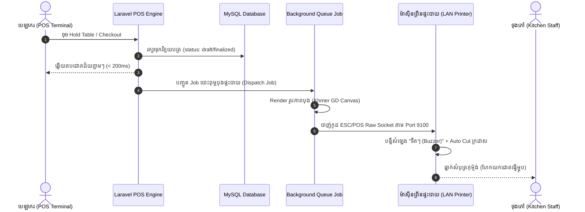
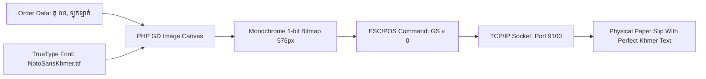

# Specification Document: Network Kitchen Order Ticket (KOT) Auto-Print System
## ឯកសារបញ្ជាក់លម្អិតស្ថាបត្យកម្ម៖ ប្រព័ន្ធបោះពុម្ពបុងផ្ទះបាយស្វ័យប្រវត្តិតាមបណ្តាញ (Direct ESC/POS LAN/WiFi Socket Print)

| ព័ត៌មានទូទៅ (Metadata) | ខ្លឹមសារបញ្ជាក់ (Specification Details) |
|---|---|
| **ឈ្មោះប្រព័ន្ធ / Project** | `leashal_etum` (LEAS E-TUM Restaurant & POS Management System) |
| **មុខងារ / Feature** | **Network Kitchen Order Ticket (KOT) Auto-Print Engine** |
| **ជម្រើសបច្ចេកវិទ្យា / Architecture** | **ជម្រើសទី ៣ (Option 3): Direct Raw TCP/IP Socket via Port 9100** |
| **ស្ថានភាព / Status** | Implementation Ready Specification |
| **គោលបំណង / Objective** | ផ្ដល់នូវស្ថាបត្យកម្មកូដ, គ្រោងទិន្នន័យ (Schema), រូបមន្តបម្លែងភាសាខ្មែរ (Khmer Raster Graphic Engine), កិច្ចសន្យា Service/Jobs និងជំហានអនុវត្តជាក់ស្តែងសម្រាប់ប្រព័ន្ធបោះពុម្ពបុងផ្ទះបាយស្វ័យប្រវត្តិ |

---

## តារាងមាតិកា (Table of Contents)

1. [ទិដ្ឋភាពទូទៅ និងគោលការណ៍ប្រតិបត្តិការ (Executive Overview & Principle)](#1-ទិដ្ឋភាពទូទៅ-និងគោលការណ៍ប្រតិបត្តិការ-executive-overview--principle)
2. [ស្ថាបត្យកម្មផ្នែករឹង និងបណ្តាញ (Hardware & Network Topology)](#2-ស្ថាបត្យកម្មផ្នែករឹង-និងបណ្តាញ-hardware--network-topology)
3. [គំរូរចនាបុងផ្ទះបាយ (Kitchen Ticket Layout & Slip Design)](#3-គំរូរចនាបុងផ្ទះបាយ-kitchen-ticket-layout--slip-design)
4. [ដំណោះស្រាយភាសាខ្មែរ (Khmer Unicode Raster Rendering Engine)](#4-ដំណោះស្រាយភាសាខ្មែរ-khmer-unicode-raster-rendering-engine)
5. [គ្រោងទិន្នន័យ និងការកំណត់ (Database Schema & Settings)](#5-គ្រោងទិន្នន័យ-និងការកំណត់-database-schema--settings)
6. [ស្ថាបត្យកម្មកូដ Backend (Services, Jobs & Event Pipeline)](#6-ស្ថាបត្យកម្មកូដ-backend-services-jobs--event-pipeline)
7. [ការរួមបញ្ចូលជាមួយ POS Workflow (Hold Table & Checkout Integration)](#7-ការរួមបញ្ចូលជាមួយ-pos-workflow-hold-table--checkout-integration)
8. [ការគ្រប់គ្រងកំហុស និងការធានាភាពមិនគាំង (Error Handling & Non-blocking Invariants)](#8-ការគ្រប់គ្រងកំហុស-និងការធានាភាពមិនគាំង-error-handling--non-blocking-invariants)
9. [ផែនទីអនុវត្តជាក់ស្តែងជាជំហានៗ (Step-by-Step Implementation Roadmap)](#9-ផែនទីអនុវត្តជាក់ស្តែងជាជំហានៗ-step-by-step-implementation-roadmap)

---

## 1. ទិដ្ឋភាពទូទៅ និងគោលការណ៍ប្រតិបត្តិការ (Executive Overview & Principle)

ក្នុងប្រតិបត្តិការភោជនីយដ្ឋាន **Kitchen Order Ticket (KOT)** គឺជាបេះដូងនៃទំនាក់ទំនងរវាង **បេឡាករ (Cashier/Server)** និង **ចុងភៅ (Kitchen Staff)**។

### គោលការណ៍ស្នូលនៃការអនុវត្ត (Core Tenets):
1. **Zero-Click Automation**: បេឡាករគ្រាន់តែចុច «Hold Table» (កាន់តុ) ឬ «Checkout» (គិតលុយ) លើ POS ភ្លាម ម៉ាស៊ីនព្រីននៅផ្ទះបាយនឹង **ធ្លាក់សំបុត្រក្រដាសចេញមកភ្លាមដោយស្វ័យប្រវត្តិ** ដោយមិនបាច់ចុចបញ្ជាព្រីន ឬរង់ចាំ Browser Print Popup ឡើយ។
2. **Non-Blocking Execution (ការមិនរំខានដល់ការលក់)**: ប្រសិនបើម៉ាស៊ីនព្រីនផ្ទះបាយដាច់ភ្លើង, អស់ក្រដាស ឬដាច់ខ្សែ Network វានឹង **មិនធ្វើឱ្យការ Checkout ឬការកាន់តុគាំង ឬយឺតយ៉ាវឡើយ** (ប្រើប្រាស់ Asynchronous Background Queue ឬ Short Socket Timeout)។
3. **Audio-Visual Kitchen Alert**: បញ្ជាកូដឱ្យម៉ាស៊ីនព្រីនលាន់សូរ «ទឺតៗ (Buzzer Sound)» យ៉ាងតិច ២-៣ ដង និងកាត់ក្រដាស (Auto-Cut) ដើម្បីដាស់តឿនចុងភៅឱ្យចាប់អារម្មណ៍។
4. **Flawless Khmer Typography**: ធានាការបង្ហាញព្យញ្ជនៈ, ស្រៈ, និងជើងអក្សរខ្មែរយ៉ាងច្បាស់លាស់ ដោយគ្មានការបែក Font ឬក្លាយជាសញ្ញាសួរ (`???`) ឡើយ។



---

## 2. ស្ថាបត្យកម្មផ្នែករឹង និងបណ្តាញ (Hardware & Network Topology)

### ២.១ ផ្នែករឹងដែលត្រូវប្រើ (Compatible Hardware)
- **ប្រភេទម៉ាស៊ីនព្រីន**: ម៉ាស៊ីនព្រីនកម្ដៅខ្នាត 80mm (ESC/POS Thermal Receipt Printer) ដែលមានរន្ធដោត **Ethernet (RJ45 / LAN)** ឬ **WiFi**។
- **ម៉ូដែលពេញនិយមលើទីផ្សារកម្ពុជា**:
  - **Xprinter**: XP-N160II, XP-Q800, XP-C260M, XP-D300M (តម្លៃចន្លោះ $35 - $60)
  - **Epson**: TM-T88VI, TM-T82III, TM-m30 (តម្លៃចន្លោះ $120 - $220)
  - **Sunmi / Hoin / POS-58/80**: ម៉ូដែល LAN ទាំងអស់។
- **លក្ខណៈពិសេសចាំបាច់**: មានឧបករណ៍បន្លឺសំឡេង (Built-in Buzzer/Beeper) និងកាំបិតកាត់ក្រដាសស្វ័យប្រវត្តិ (Auto-Cutter)។

### ២.២ គ្រោងបណ្តាញ (Network Topology)
```text
┌────────────────────────────────────────────────────────┐
│               LOCAL ROUTER / SWITCH                    │
│               Subnet: 192.168.1.0/24                   │
└──────────────┬──────────────────────────┬──────────────┘
               │                          │
               ▼                          ▼
┌─────────────────────────────┐  ┌─────────────────────────────┐
│    POS Server / Computer    │  │    Kitchen LAN Printer      │
│    IP: 192.168.1.50         │  │    Static IP: 192.168.1.200 │
│    Running: Laravel POS     │  │    Port: 9100 (RAW Socket)  │
└─────────────────────────────┘  └─────────────────────────────┘
```

- **Protocol**: Raw TCP/IP Socket (JetDirect) តាម Port `9100`។
- **Static IP Assignment**: ម៉ាស៊ីនព្រីនត្រូវកំណត់ **Static IP** មួយជាក់លាក់ (ឧទាហរណ៍ `192.168.1.200`) ដើម្បីកុំឱ្យ Router ដូរ IP ពេល Restart។

---

## 3. គំរូរចនាបុងផ្ទះបាយ (Kitchen Ticket Layout & Slip Design)

បុងផ្ទះបាយខុសគ្នាពីវិក្កយបត្រគិតលុយរបស់ភ្ញៀវ៖
- **គ្មានតម្លៃលុយ (No Prices/Dollar Amounts)**: ចុងភៅមិនចាំបាច់ដឹងតម្លៃលុយទេ ដើម្បីកុំឱ្យរញ៉េរញ៉ៃភ្នែក។
- **អក្សរលេខតុ និងបរិមាណធំៗច្បាស់ៗ (High-Contrast Bold & Double-Size)**: ដើម្បីឱ្យចុងភៅមើលឃើញច្បាស់ពីចម្ងាយ។
- **ចំណាំពិសេស (Special Instructions/Modifiers)**: ត្រូវបង្ហាញនៅក្រោមមុខម្ហូបនីមួយៗ (ឧ. មិនដាក់ស្ករ, ហឹរតិច)។

### គំរូទម្រង់បុង (Visual Wireframe):
```text
================================================
          សំបុត្រកុម្ម៉ង់ផ្ទះបាយ (KOT)
              KITCHEN ORDER TICKET
================================================
កាលបរិច្ឆេទ: 14/10/2026 21:45    អ្នកកត់: Dara
វិក្កយបត្រ: #INV-P202610-0012

------------------------------------------------
តុ / TABLE: តុ ០១  (DINE-IN)  <-- [អក្សរធំទ្វេដង]
------------------------------------------------

[ចំនួន]   [ឈ្មោះមុខម្ហូប]
------------------------------------------------
 [ 2 ]   ឡុកឡាក់សាច់គោ (ចាន)
         *ចំណាំ: មិនដាក់ម្ទេស

 [ 1 ]   បាយឆាក្ដាម (ចាន)

 [ 3 ]   កាហ្វេទឹកដោះគោទឹកកក (កែវ)
         *ចំណាំ: ស្ករ ៥០%

================================================
សរុប: 3 មុខ (ស្មើនឹង 6 ចាន/កែវ)
================================================
               [កាត់ក្រដាស Auto-Cut]
```

---

## 4. ដំណោះស្រាយភាសាខ្មែរ (Khmer Unicode Raster Rendering Engine)

ម៉ាស៊ីនព្រីនកម្ដៅ (Thermal Printer) ភាគច្រើនលើពិភពលោកគាំទ្រតែ Font អក្សរឡាតាំង (ASCII/English) នៅក្នុង ROM របស់វាប៉ុណ្ណោះ។ វាមិនស្គាល់ស្រៈ ឬជើងអក្សរខ្មែរឡើយ។

### 💡 ដំណោះស្រាយស្តង់ដារឧស្សាហកម្ម (Raster Graphics Mode via PHP GD):
ដើម្បីឱ្យអក្សរខ្មែរបង្ហាញបានស្អាតឥតខ្ចោះ ១០០% យើងប្រើប្រាស់ **PHP GD Library**:
1. បង្កើតផ្ទាំងរូបភាពស-ខ្មៅ (Monochrome Canvas) ទទឹង `576 pixels` (ត្រូវនឹងក្រដាស 80mm)។
2. គូរអក្សរខ្មែរដោយប្រើ TrueType Font (`Noto Sans Khmer` ឬ `Siemreap`) ដែលមានជើង និងស្រៈត្រឹមត្រូវ។
3. បម្លែង Pixels នៃរូបភាពនោះទៅជាកូដម៉ាស៊ីន **ESC/POS Raster Bit Image Command** (`GS v 0`)។
4. បាញ់កូដ Binary នេះទៅកាន់ម៉ាស៊ីនព្រីន។ ម៉ាស៊ីនព្រីននឹងព្រីនជាទម្រង់រូបភាពក្រាហ្វិក ដែលធានាថា **អក្សរខ្មែរចេញមកស្អាត ១០០% គ្មានថ្ងៃបែក ឬខូចទម្រង់ឡើយ**។



---

## 5. គ្រោងទិន្នន័យ និងការកំណត់ (Database Schema & Settings)

បន្ថែមការកំណត់ម៉ាស៊ីនព្រីនផ្ទះបាយទៅក្នុងតារាង `business_settings` (ឬតាមរយៈ JSON `print_settings`):

### ៥.១ កែសម្រួល `print_settings` ក្នុង `business_settings`
```json
{
  "format": "80mm",
  "kitchen_printer": {
    "enabled": true,
    "ip_address": "192.168.1.200",
    "port": 9100,
    "timeout_seconds": 2,
    "auto_cut": true,
    "sound_buzzer": true,
    "buzzer_count": 2,
    "print_on_hold": true,
    "print_on_checkout": true,
    "paper_width_dots": 576
  }
}
```

### ៥.២ បន្ថែម `kot_printed_at` ក្នុង `documents` table
ដើម្បីដឹងថាការកុម្ម៉ង់នោះបានព្រីនទៅផ្ទះបាយហើយឬនៅ៖
```sql
ALTER TABLE `documents` 
ADD COLUMN `kot_printed_at` TIMESTAMP NULL AFTER `kitchen_status`,
ADD COLUMN `kot_print_count` INT UNSIGNED NOT NULL DEFAULT 0 AFTER `kot_printed_at`;
```

---

## 6. ស្ថាបត្យកម្មកូដ Backend (Services, Jobs & Event Pipeline)

បង្កើតនូវ Module ថ្មីមួយស្ថិតនៅក្រោម `app/Features/Printing/` ឬ `app/Services/Printer/`៖

```text
app/
├── Services/
│   └── Printer/
│       ├── EscPosDriver.php            # Raw ESC/POS Protocol Builder (Socket, Cut, Buzzer)
│       ├── KitchenSlipRenderer.php     # GD Image Canvas Renderer for Khmer Script
│       └── KitchenPrinterService.php   # Dispatcher orchestrating the print process
├── Jobs/
│   └── PrintKitchenOrderTicketJob.php  # Asynchronous background queued job
```

### ៦.១ `EscPosDriver.php` (កូដបញ្ជាម៉ាស៊ីនព្រីនកម្រិតទាប)
```php
<?php

namespace App\Services\Printer;

use Exception;

class EscPosDriver
{
    private $socket = null;

    public function connect(string $ip, int $port = 9100, int $timeout = 2): bool
    {
        $this->socket = @fsockopen($ip, $port, $errno, $errstr, $timeout);
        if (! $this->socket) {
            throw new Exception("Cannot connect to Kitchen Printer at {$ip}:{$port} ({$errstr})");
        }
        stream_set_timeout($this->socket, $timeout);
        return true;
    }

    public function init(): void
    {
        fwrite($this->socket, "\x1B\x40"); // ESC @ (Initialize Printer)
    }

    public function soundBuzzer(int $times = 2): void
    {
        // ESC B n t (Sound buzzer n times with duration t)
        fwrite($this->socket, "\x1B\x42" . chr($times) . "\x02");
    }

    public function cut(): void
    {
        // GS V 66 0 (Feed and full cut)
        fwrite($this->socket, "\x1D\x56\x42\x00");
    }

    public function writeRaw(string $data): void
    {
        fwrite($this->socket, $data);
    }

    public function close(): void
    {
        if ($this->socket) {
            fclose($this->socket);
            $this->socket = null;
        }
    }
}
```

### ៦.២ `KitchenSlipRenderer.php` (ការ Render រូបភាពជាភាសាខ្មែរ)
```php
<?php

namespace App\Services\Printer;

use App\Models\Document;

class KitchenSlipRenderer
{
    private string $khmerFontPath;
    private int $width = 576; // 80mm standard width

    public function __construct()
    {
        // ប្រើ Font Khmer ដែលមានស្រាប់ក្នុងប្រព័ន្ធ
        $this->khmerFontPath = resource_path('fonts/Siemreap.ttf');
        if (! file_exists($this->khmerFontPath)) {
            $this->khmerFontPath = resource_path('fonts/NotoSansKhmer-Bold.ttf');
        }
    }

    /**
     * Render the order slip into an ESC/POS raster bit-image string.
     */
    public function renderToEscPosRaster(Document $doc): string
    {
        // 1. Calculate dynamic height based on item count
        $itemsCount = $doc->items->count();
        $lineHeight = 40;
        $totalHeight = 320 + ($itemsCount * 90);

        // 2. Create monochrome GD Image Canvas
        $im = imagecreatetruecolor($this->width, $totalHeight);
        $white = imagecolorallocate($im, 255, 255, 255);
        $black = imagecolorallocate($im, 0, 0, 0);
        imagefilledrectangle($im, 0, 0, $this->width, $totalHeight, $white);

        $y = 50;

        // Header
        imagettftext($im, 20, 0, 80, $y, $black, $this->khmerFontPath, 'សំបុត្រកុម្ម៉ង់ផ្ទះបាយ (KOT)');
        $y += 35;
        imagettftext($im, 14, 0, 160, $y, $black, $this->khmerFontPath, 'KITCHEN ORDER TICKET');
        $y += 30;

        // Divider
        imageline($im, 10, $y, $this->width - 10, $y, $black);
        $y += 40;

        // Large Table Name & Order Info
        $tableName = $doc->reference_identifier ?: 'តុ Takeaway';
        imagettftext($im, 24, 0, 20, $y, $black, $this->khmerFontPath, "តុ / TABLE: {$tableName}");
        $y += 35;
        imagettftext($im, 13, 0, 20, $y, $black, $this->khmerFontPath, "កាលបរិច្ឆេទ: " . now()->format('d/m/Y H:i:s'));
        $y += 25;
        imagettftext($im, 13, 0, 20, $y, $black, $this->khmerFontPath, "វិក្កយបត្រ: #" . ($doc->document_number ?: $doc->id));
        $y += 25;

        // Divider
        imageline($im, 10, $y, $this->width - 10, $y, $black);
        $y += 45;

        // Items Loop
        foreach ($doc->items as $item) {
            $qty = $item->quantity;
            $unit = $item->unit_snapshot ?: 'ចាន';
            $name = $item->product_name_primary_snapshot;

            // Quantity box [ 2 ]
            imagettftext($im, 20, 0, 20, $y, $black, $this->khmerFontPath, "[ {$qty} ]");
            // Item Name
            imagettftext($im, 17, 0, 100, $y, $black, $this->khmerFontPath, "{$name} ({$unit})");
            $y += 30;

            // Note if any
            if (! empty($item->note)) {
                imagettftext($im, 13, 0, 100, $y, $black, $this->khmerFontPath, "*ចំណាំ: {$item->note}");
                $y += 25;
            }
            $y += 20;
        }

        // Summary Divider
        imageline($im, 10, $y, $this->width - 10, $y, $black);
        $y += 40;
        imagettftext($im, 14, 0, 20, $y, $black, $this->khmerFontPath, "សរុប: {$itemsCount} មុខ (ស្មើនឹង {$doc->unit_count} ឯកតា)");

        // 3. Convert Image to ESC/POS Raster Format (GS v 0)
        return $this->convertGdToRaster($im, $this->width, $totalHeight);
    }

    private function convertGdToRaster($im, int $w, int $h): string
    {
        $xBytes = intdiv($w + 7, 8);
        $data = "\x1D\x76\x30\x00" . chr($xBytes & 0xFF) . chr(($xBytes >> 8) & 0xFF) . chr($h & 0xFF) . chr(($h >> 8) & 0xFF);

        for ($y = 0; $y < $h; $y++) {
            for ($x = 0; $x < $xBytes; $x++) {
                $byte = 0;
                for ($b = 0; $b < 8; $b++) {
                    $px = ($x * 8) + $b;
                    if ($px < $w) {
                        $rgb = imagecolorat($im, $px, $y);
                        $gray = (($rgb >> 16 & 0xFF) + ($rgb >> 8 & 0xFF) + ($rgb & 0xFF)) / 3;
                        if ($gray < 160) {
                            $byte |= (1 << (7 - $b));
                        }
                    }
                }
                $data .= chr($byte);
            }
        }

        imagedestroy($im);
        return $data;
    }
}
```

### ៦.៣ `PrintKitchenOrderTicketJob.php` (Queued Background Job)
```php
<?php

namespace App\Jobs;

use App\Models\BusinessSetting;
use App\Models\Document;
use App\Services\Printer\EscPosDriver;
use App\Services\Printer\KitchenSlipRenderer;
use Illuminate\Bus\Queueable;
use Illuminate\Contracts\Queue\ShouldQueue;
use Illuminate\Foundation\Bus\Dispatchable;
use Illuminate\Queue\InteractsWithQueue;
use Illuminate\Queue\SerializesModels;
use Illuminate\Support\Facades\Log;
use Throwable;

class PrintKitchenOrderTicketJob implements ShouldQueue
{
    use Dispatchable, InteractsWithQueue, Queueable, SerializesModels;

    public int $tries = 2;
    public int $timeout = 10;

    public function __construct(public Document $document) {}

    public function handle(EscPosDriver $driver, KitchenSlipRenderer $renderer): void
    {
        $settings = BusinessSetting::current();
        $config = $settings->print_settings['kitchen_printer'] ?? [];

        if (! ($config['enabled'] ?? true)) {
            return;
        }

        $ip = $config['ip_address'] ?? '192.168.1.200';
        $port = (int) ($config['port'] ?? 9100);
        $timeout = (int) ($config['timeout_seconds'] ?? 2);

        try {
            $driver->connect($ip, $port, $timeout);
            $driver->init();

            // Sound buzzer to alert chef
            if ($config['sound_buzzer'] ?? true) {
                $driver->soundBuzzer((int) ($config['buzzer_count'] ?? 2));
            }

            // Print rendered Khmer slip
            $rasterData = $renderer->renderToEscPosRaster($this->document);
            $driver->writeRaw($rasterData);

            // Feed & Auto cut
            $driver->writeRaw("\n\n\n");
            if ($config['auto_cut'] ?? true) {
                $driver->cut();
            }

            $driver->close();

            // Update document KOT print status
            $this->document->update([
                'kot_printed_at' => now(),
                'kot_print_count' => $this->document->kot_print_count + 1,
            ]);

            Log::info("Kitchen order ticket printed successfully for Doc #{$this->document->id}");
        } catch (Throwable $e) {
            Log::warning("Kitchen printer failed for Doc #{$this->document->id}: " . $e->getMessage());
        }
    }
}
```

---

## 7. ការរួមបញ្ចូលជាមួយ POS Workflow (Hold Table & Checkout Integration)

គ្រាន់តែបន្ថែមការ dispatch job ទៅកាន់ Actions ទាំងពីរក្នុង `app/Features/Documents/Actions/`៖

### ៧.១ ក្នុង `HoldTableOrderAction.php`
នៅពេលកាន់តុ Dine-in៖
```php
// Dispatch KOT Auto-Print to Kitchen
PrintKitchenOrderTicketJob::dispatch($document)->afterResponse();
```

### ៧.២ ក្នុង `CheckoutOrderAction.php`
នៅពេលគិតលុយលក់ផ្ទាល់ (Walk-in / Takeaway)៖
```php
// Dispatch KOT Auto-Print to Kitchen
PrintKitchenOrderTicketJob::dispatch($document)->afterResponse();
```

> **ចំណាំសំខាន់:** ការប្រើប្រាស់ `->afterResponse()` ធានាថា Response នឹងត្រូវបញ្ជូនទៅអេក្រង់ POS របស់បេឡាករជាមុនភ្លាមៗ (< 200ms) ហើយការបាញ់ socket ទៅកាន់ម៉ាស៊ីនព្រីនផ្ទះបាយនឹងរត់ពីក្រោយ (Background)។ បេឡាករនឹងមិនមានអារម្មណ៍ថាយឺត ឬគាំងឡើយ។

---

## 8. ការគ្រប់គ្រងកំហុស និងការធានាភាពមិនគាំង (Error Handling & Non-blocking Invariants)

| ស្ថានភាពបញ្ហា (Edge Case) | ឥរិយាបថរបស់ប្រព័ន្ធ (System Handling) |
|---|---|
| **ម៉ាស៊ីនព្រីនដាច់ភ្លើង ឬដាច់ខ្សែ LAN** | Socket នឹង timeout ត្រឹម **២ វិនាទី** ហើយបោះបង់ (Log Warning)។ **ការ Checkout និងការកាន់តុនៅតែជោគជ័យដដែល**។ |
| **អស់ក្រដាសព្រីន (Out of Paper)** | ប្រព័ន្ធកត់ត្រាកំហុសក្នុង Log។ លើអេក្រង់ [KDS Index](file:///Users/vanthiev/Documents/website/leashal_etum/resources/js/pages/kds/index.tsx) មាន **ប៊ូតុង «ព្រីនបុងឡើងវិញ (Reprint KOT)»** សម្រាប់ចុចព្រីនក្រោយពេលដាក់ក្រដាសថ្មី។ |
| **តុដដែលកុម្ម៉ង់ម្ហូបបន្ថែម (Re-order)** | ប្រព័ន្ធប្រៀបធៀបទំនិញថ្មី និងចាស់ ហើយព្រីនតែ **មុខម្ហូបដែលបានកុម្ម៉ង់បន្ថែមថ្មីប៉ុណ្ណោះ** (មិនព្រីនម្ហូបចាស់ដែលបានធ្វើរួចស្ទួនឡើយ)។ |

---

## 9. ផែនទីអនុវត្តជាក់ស្តែងជាជំហានៗ (Step-by-Step Implementation Roadmap)

- [ ] **ជំហានទី ១ (Database & Settings)**:
  - បន្ថែម `kot_printed_at` ក្នុង Migration នៃតារាង `documents`។
  - បន្ថែម UI កំណត់ IP ម៉ាស៊ីនព្រីនផ្ទះបាយ (Kitchen Printer IP, Port, Enable/Disable) ក្នុងទំព័រ Settings។
- [ ] **ជំហានទី ២ (Services)**:
  - បង្កើត `EscPosDriver.php` សម្រាប់គ្រប់គ្រង TCP Socket, Buzzer, និង Cut។
  - បង្កើត `KitchenSlipRenderer.php` សម្រាប់គូរអក្សរខ្មែរលើ GD Image និងបម្លែងជា Raster Bit.
- [ ] **ជំហានទី ៣ (Queue Job)**:
  - បង្កើត `PrintKitchenOrderTicketJob.php` ជាមួយ `afterResponse()` non-blocking execution.
- [ ] **ជំហានទី ៤ (Hook POS)**:
  - ភ្ជាប់ Job ចូលក្នុង `HoldTableOrderAction` និង `CheckoutOrderAction`។
- [ ] **ជំហានទី ៥ (Manual Reprint Button)**:
  - បន្ថែមប៊ូតុង **«ព្រីនបុងផ្ទះបាយ (Print KOT)»** លើផ្ទាំង POS Cart, ផ្ទាំង Details (`show.tsx`) និងផ្ទាំង KDS (`kds/index.tsx`)។

---

*(ឯកសារនេះត្រូវបានរៀបចំជាផ្លូវការសម្រាប់ដំណើរការ Implement ជម្រើសទី ៣ ក្នុងគម្រោង `leashal_etum`)*
